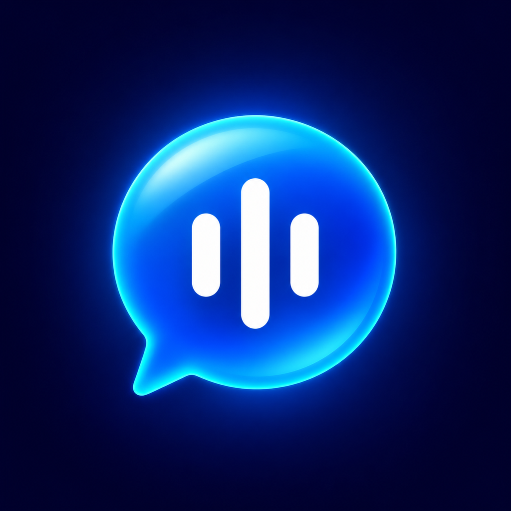

# WristChat

**ChatGPT на Apple Watch.** Задавай вопросы с запястья, набирай текст или диктуй голосом. Ответ появляется прямо в чате, его можно прочитать или послушать. iPhone нужен для первого входа и просмотра той же переписки.

**[Скачать последнюю сборку](https://github.com/Lengader/WristChat/releases/latest)** · [Все версии](https://github.com/Lengader/WristChat/releases)

## Что умеет

- **Чат с часов.** Создавай отдельные диалоги, возвращайся к истории и прикладывай фото, доступные на часах. Отправка фото зависит от поддержки изображений выбранной моделью.
- **Потоковые ответы.** Текст появляется по мере генерации. Кнопка «Стоп» сохраняет уже полученную часть, а «Прочитать» озвучивает ответ.
- **История на iPhone.** Переписка синхронизируется между WristChat на часах и приложением на iPhone.
- **Режим ответа.** «Быстро», «Авто» и «Думать дольше» можно настроить на любом из двух устройств для отдельного чата или по умолчанию.
- **Формулы.** На обоих экранах LaTeX отображается с дробными чертами, вложенными корнями и матрицами. Широкие выражения можно прокрутить вбок.

## Установка с Windows

Понадобятся **iPhone с iOS 18+**, связанные с ним **Apple Watch с watchOS 11+** и Windows‑ПК с USB‑кабелем. Для установки используются [Apple Devices](https://apps.microsoft.com/detail/9np83lwlpz9k) и [WatchBridge](https://github.com/AdminZachary/WatchBridge/releases).

1. Открой [последний релиз](https://github.com/Lengader/WristChat/releases/latest) и в **Assets** скачай `WristChat-…-unsigned.ipa`.
2. Подключи разблокированный iPhone по USB. Открой WatchBridge, подготовь режим разработчика на часах, затем подпиши и установи `.ipa`. [Инструкция WatchBridge](https://github.com/AdminZachary/WatchBridge#how-it-works)
3. Открой **WristChat на iPhone → Continue with ChatGPT** и разреши использование подписки. После этого открой WristChat на часах и создай чат.

Обновления можно ставить поверх текущей версии с тем же аккаунтом подписи, чтобы сохранить историю. При бесплатной подписи Apple приложение нужно переподписывать каждые 7 дней. [Условия Apple Personal Team](https://developer.apple.com/help/account/basics/about-your-developer-account/)

## Подписка, модель и переписка

WristChat использует твою подписку через [Sign in with ChatGPT](https://developers.openai.com/siwc/quickstart). Если аккаунту доступна **GPT‑6.2 Sol**, приложение выбирает её. Иначе оно берёт первую доступную модель из каталога. Её имя видно рядом с ответом, а расход можно посмотреть в [ChatGPT → Settings → Usage](https://chatgpt.com/settings/usage).

Часы обращаются напрямую к OpenAI. История WristChat хранится на устройствах и синхронизируется между связанными часами и iPhone. Переписка в ChatGPT ведётся отдельно.

## Сборка из исходников

Клиенты для iPhone и Apple Watch написаны на SwiftUI, формулы отрисовывает [SwaTex](https://github.com/PhraseHQ/SwaTex). Оба приложения собираются в один неподписанный `.ipa`.

- **В GitHub Actions.** Запусти **Build test IPA** и скачай артефакт `WristChat-unsigned`. Сборка выполняется на macOS‑раннере и запускается с любого компьютера.
- **В Xcode.** Выполни `xcodegen generate`, открой `WristChat.xcodeproj` и выбери нужную схему.
- **Для релиза.** Отправь тег `vX.Y.Z`, совпадающий с `MARKETING_VERSION` в `project.yml`. После успешной сборки workflow публикует `.ipa` в [GitHub Releases](https://github.com/Lengader/WristChat/releases).
