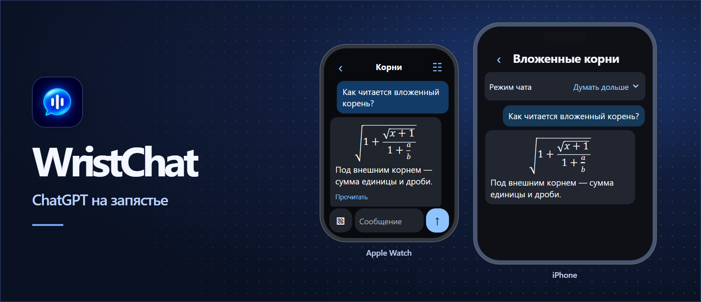
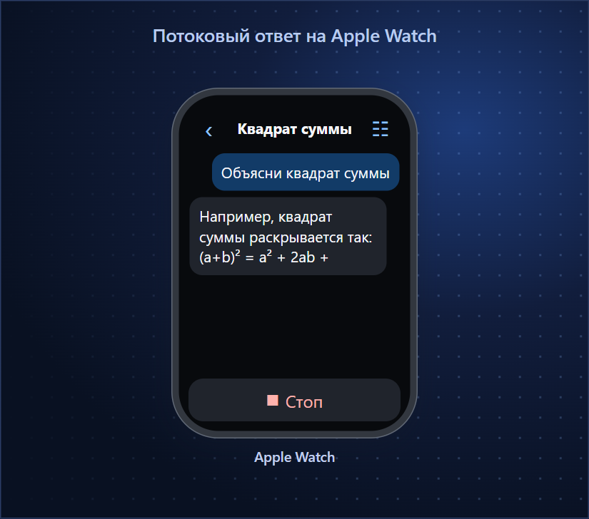
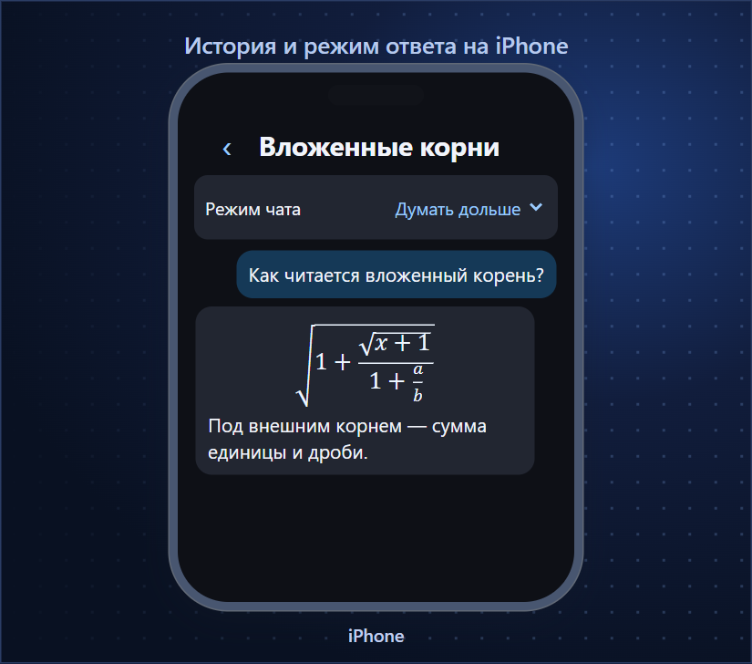

# 

**ChatGPT на Apple Watch.** Задавай вопросы с запястья, набирай текст или диктуй голосом. Ответ появляется прямо в чате, его можно прочитать или послушать. iPhone нужен для первого входа и просмотра той же переписки.

**[Скачать последнюю сборку](https://github.com/Lengader/WristChat/releases/latest)** · [Установка с Windows](#установка-с-windows) · [Все версии](https://github.com/Lengader/WristChat/releases)

## Как выглядит

| Apple Watch | iPhone |
| --- | --- |
|  |  |

*Скриншоты интерактивного макета с демонстрационными сообщениями.*

## Что умеет

- **Чат с часов.** Создавай отдельные диалоги, возвращайся к истории и прикладывай фото, доступные на часах. Отправка фото зависит от поддержки изображений выбранной моделью.
- **Потоковые ответы.** Текст появляется по мере генерации. Кнопка «Стоп» сохраняет уже полученную часть, а «Прочитать» озвучивает ответ.
- **История на iPhone.** Переписка синхронизируется между WristChat на часах и приложением на iPhone.
- **Режим ответа.** «Быстро», «Авто» и «Думать дольше» можно настроить на любом из двух устройств для отдельного чата или по умолчанию.
- **Формулы.** На обоих экранах LaTeX отображается с дробными чертами, вложенными корнями и матрицами. Широкие выражения можно прокрутить вбок.

## Установка с Windows

Понадобятся **Windows 10 22H2 или Windows 11 (x64)**, USB‑кабель с передачей данных, **iPhone с iOS 18+** и уже связанные с ним **Apple Watch с watchOS 11+**. Apple Account нужен для подписи приложения, а аккаунт ChatGPT с доступом к использованию подписки — для ответов.

### 1. Подготовь Windows и подключи iPhone

1. Установи **Apple Devices** из Microsoft Store и открой его. [Apple Devices](https://apps.microsoft.com/detail/9np83lwlpz9k)
2. Подключи iPhone кабелем и разблокируй его. Если появится вопрос **«Доверять этому компьютеру?»**, нажми **«Доверять»** и введи код iPhone. Проверь, что телефон появился в боковой панели Apple Devices. [Инструкция Apple](https://support.apple.com/en-gb/108643)
3. Скачай `watchbridge-windows.zip` из раздела **Assets**, распакуй архив в папку и запусти `WatchBridge.exe`. Названия кнопок ниже приведены для английского интерфейса WatchBridge 0.1.6. [Релизы WatchBridge](https://github.com/AdminZachary/WatchBridge/releases)
4. Скачай `WristChat-…-unsigned.ipa` из раздела **Assets** последнего релиза WristChat. Оставь `.ipa` целиком, чтобы WatchBridge смог установить обе части приложения. [Последний релиз WristChat](https://github.com/Lengader/WristChat/releases/latest)

### 2. Включи режим разработчика на часах

1. В левой панели WatchBridge выбери подключение iPhone **по USB**. Держи iPhone и часы рядом, оба устройства — разблокированными.
2. В **Prepare developer mode** нажми **Pair Watch**. Если часы попросят подтвердить доверие, сделай это прямо на них.
3. Если пункта **«Режим разработчика»** на часах пока нет, нажми **Show developer mode switch** в WatchBridge. Затем на часах зайди в **Настройки → Конфиденциальность и безопасность → Режим разработчика**.
4. Включи переключатель и согласись перезапустить часы. После перезапуска разблокируй их, нажми **«Включить»** и подтверди кодом, если часы попросят.
5. В WatchBridge нажми **Check again**. Переходи к установке, когда появится **Confirmed on**. [Инструкция WatchBridge](https://github.com/AdminZachary/WatchBridge#how-it-works) · [Инструкция Apple](https://developer.apple.com/documentation/xcode/enabling-developer-mode-on-a-device)

### 3. Подпиши и установи WristChat

1. В WatchBridge войди в **Apple ID** через левую панель. Если Apple попросит код подтверждения, введи его в окне входа WatchBridge.
2. В **Install the Watch app** нажми **Choose IPA**, выбери `WristChat-…-unsigned.ipa`, затем нажми **Sign and install**.
3. Оставь iPhone подключённым, а часы — рядом и разблокированными, пока WatchBridge ставит приложение на оба устройства. После сообщения **Install flow finished** найди **WristChat** в списке приложений на часах и открой его.

### 4. Подключи ChatGPT и проверь первый ответ

1. Открой WristChat на iPhone и нажми **Continue with ChatGPT**. В окне OpenAI войди в свой аккаунт и разреши WristChat использовать подписку для запросов.
2. Открой WristChat на часах, нажми **«Новый чат»**, отправь короткий вопрос и дождись ответа. После этого USB‑кабель можно отсоединить. Для ответов часам нужен доступ к интернету.

### Обновление и продление подписи

Новый `.ipa` устанавливай через WatchBridge **поверх текущей версии**, с тем же Apple Account для подписи. Так сохранится локальная история. При бесплатной подписи Apple профиль действует **7 дней**. Чтобы продлить его вручную, снова установи тот же `.ipa` поверх приложения через WatchBridge. [Условия Apple Personal Team](https://developer.apple.com/help/account/basics/about-your-developer-account/)

### Если что-то пошло не так

| Что видно | Что попробовать |
| --- | --- |
| iPhone заряжается, но его нет в Apple Devices | Разблокируй iPhone, переподключи его, проверь запрос «Доверять» и попробуй другой USB‑порт или кабель с передачей данных. [Поддержка Apple](https://support.apple.com/en-gb/108643) |
| WatchBridge не видит часы или переключатель так и не появился | Выбери USB‑подключение iPhone, оставь экран часов включённым и заново пройди **Pair Watch → Show developer mode switch**. После перезапуска WatchBridge сопряжение в нём нужно повторить. |
| На iPhone появилось сообщение о выключенном режиме разработчика | Открой **Настройки → Конфиденциальность и безопасность → Режим разработчика** уже на iPhone. Включи его, перезапусти телефон и подтверди включение. [Инструкция Apple](https://developer.apple.com/documentation/xcode/enabling-developer-mode-on-a-device) |
| **Continue with ChatGPT** неактивна | Убедись, что WristChat установлен на связанных часах, открой его на часах и вернись в приложение на iPhone. |
| Приложение перестало открываться спустя неделю | Переподпиши тот же `.ipa` и установи его поверх текущей версии. |

## Подписка, модель и переписка

WristChat использует твою подписку через [Sign in with ChatGPT](https://developers.openai.com/siwc/quickstart). Если аккаунту доступна **GPT‑6.2 Sol**, приложение выбирает её. Иначе оно берёт первую доступную модель из каталога. Её имя видно рядом с ответом, а расход можно посмотреть в [ChatGPT → Settings → Usage](https://chatgpt.com/settings/usage).

Часы обращаются напрямую к OpenAI. История WristChat хранится на устройствах и синхронизируется между связанными часами и iPhone. Переписка в ChatGPT ведётся отдельно.

## Сборка из исходников

Клиенты для iPhone и Apple Watch написаны на SwiftUI, формулы отрисовывает [SwaTex](https://github.com/PhraseHQ/SwaTex). Оба приложения собираются в один неподписанный `.ipa`.

- **В GitHub Actions.** Запусти **Build test IPA** и скачай артефакт `WristChat-unsigned`. Сборка выполняется на macOS‑раннере и запускается с любого компьютера.
- **В Xcode.** Выполни `xcodegen generate`, открой `WristChat.xcodeproj` и выбери нужную схему.
- **Для релиза.** Отправь тег `vX.Y.Z`, совпадающий с `MARKETING_VERSION` в `project.yml`. После успешной сборки workflow публикует `.ipa` в [GitHub Releases](https://github.com/Lengader/WristChat/releases).
